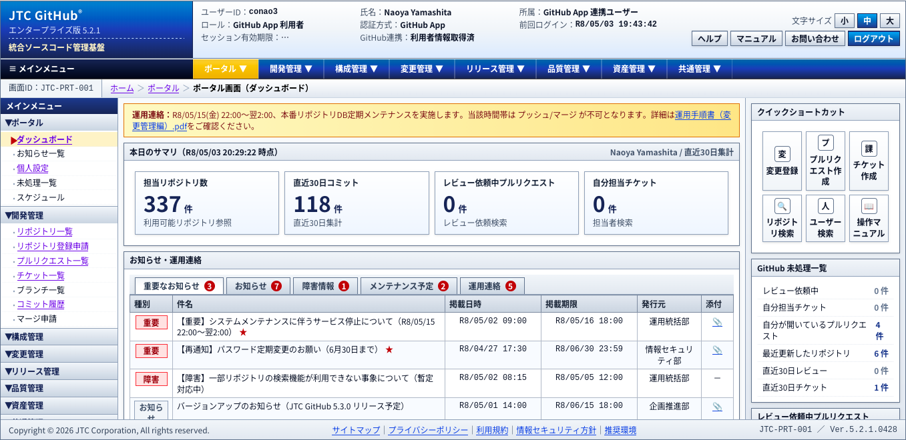
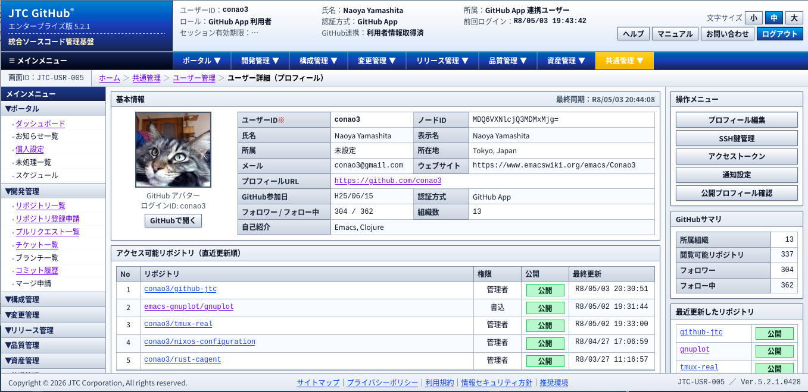
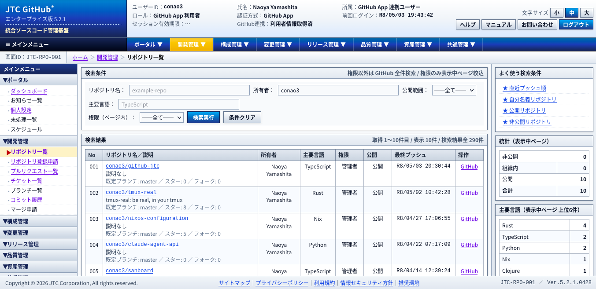
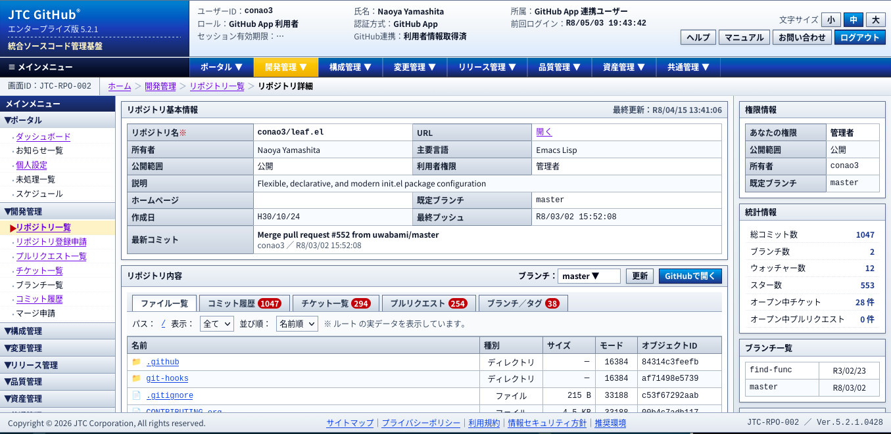

# github-jtc

A JTC-style GitHub frontend PoC.

## Screenshots






## Deploy

This repository assumes the following deployment split:

- GitHub Pages: frontend hosting
- Cloudflare Worker: GitHub App `code -> access token` exchange

### GitHub repository variables

- `APP_CLIENT_ID`
  GitHub App Client ID
- `APP_EXCHANGE_URL`
  Example:
  `https://github-jtc-auth-broker.<subdomain>.workers.dev/api/auth/github/exchange`
- `PAGES_BASE_PATH` optional
  Base path override when deploying somewhere other than a standard project site.
  If unset, it is derived from the repository name.
- `PAGES_BASE_URL` optional
  Full Pages URL used to derive the Worker's `ALLOWED_ORIGINS`.
- `WORKER_ALLOWED_ORIGINS` optional
  Comma-separated list of allowed origins for the Worker when you want to override
  auto-detection explicitly. Use origin values only, for example
  `https://conao3.github.io,http://localhost:5174`.
- `APP_REDIRECT_URI` optional
  Set this only if you want to hard-code the GitHub App callback URL.

### GitHub secrets

Set these as secrets of the `production` environment or of the repository.

- `CLOUDFLARE_API_TOKEN`
  Used for Worker deployment
- `APP_CLIENT_SECRET`
  GitHub App Client Secret

### GitHub App settings

- Callback URL:
  `https://<owner>.github.io/<repo>/login/callback`
  For a user or organization site, use `https://<owner>.github.io/login/callback`.

### Workflows

- `.github/workflows/build.yml`
  Builds the site on pushes to `master` and on pull requests
- `.github/workflows/deploy-pages.yml`
  Builds the site and deploys it to GitHub Pages in the `github-pages` environment
- `.github/workflows/deploy-worker.yml`
  Deploys the Cloudflare Worker in the `production` environment

Both deploy workflows run only by manual dispatch from `master`, which is the only branch the `github-pages` and `production` environments allow:

```sh
gh workflow run deploy-pages.yml --ref master
gh workflow run deploy-worker.yml --ref master
```
